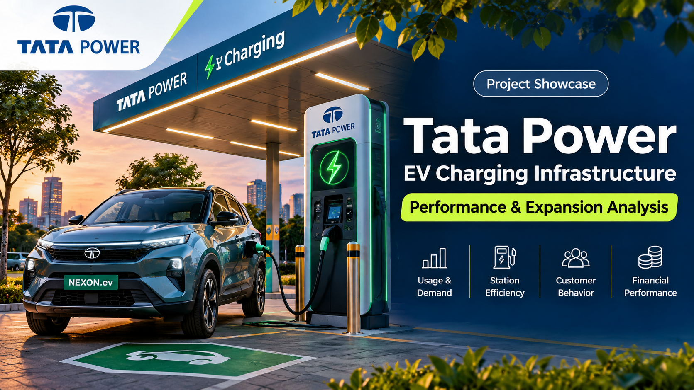
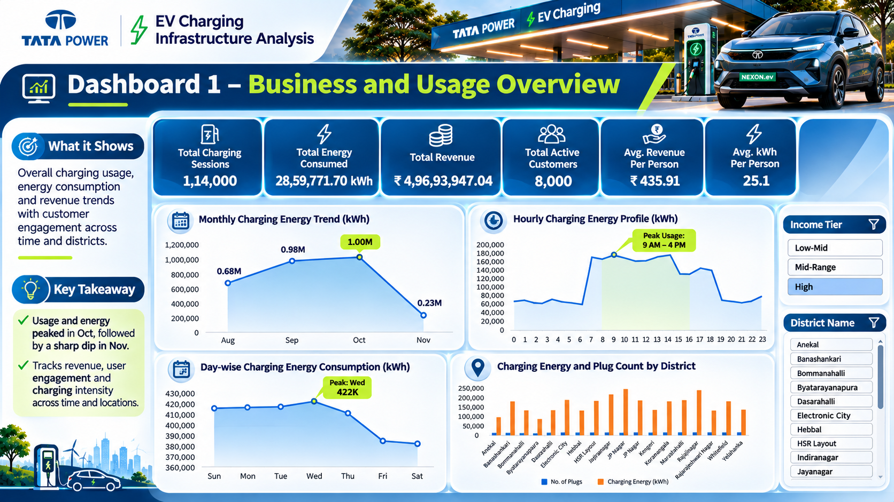
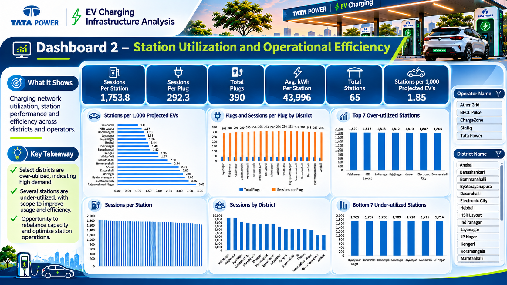
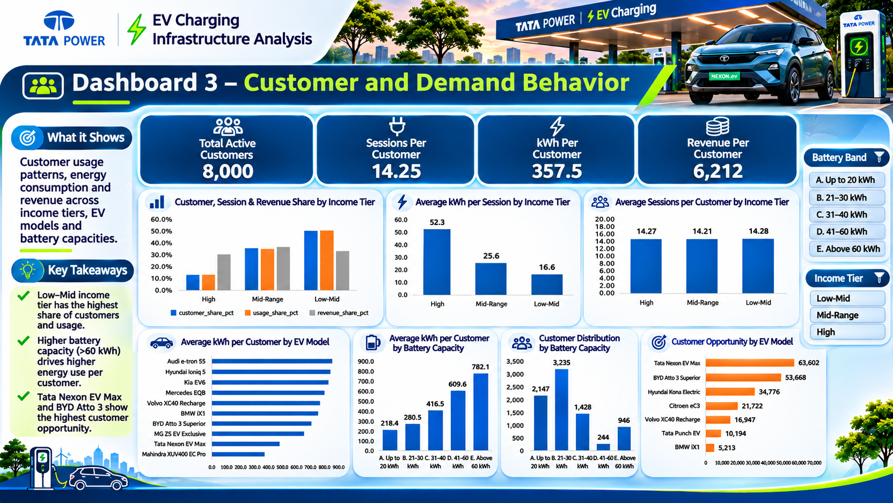
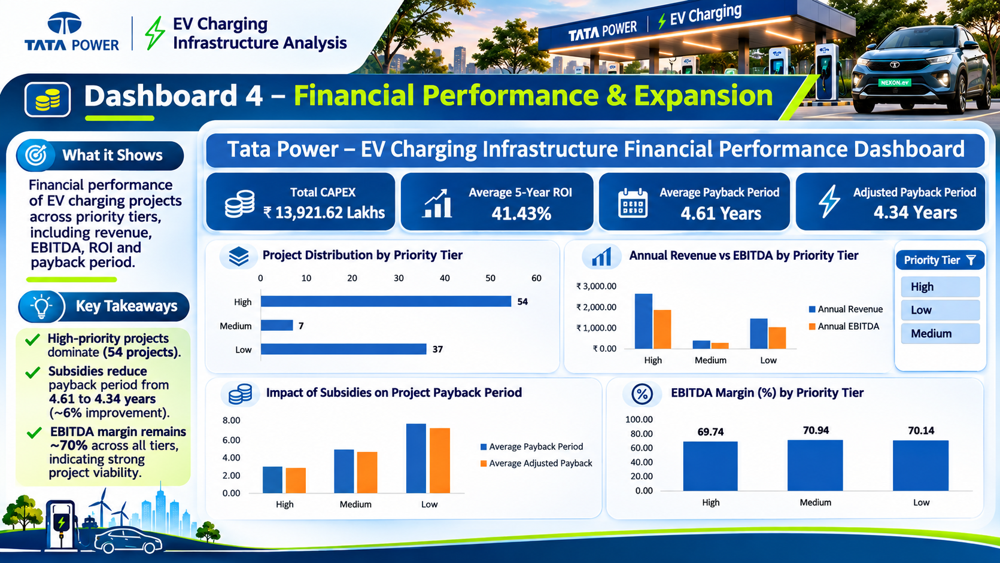

# ⚡ Tata Power – EV Charging Infrastructure Analysis

### 📊 Business Analytics | Excel | Power Query | Power Pivot | Interactive Dashboards

An end-to-end business analytics project evaluating the operational performance, customer demand, financial profitability, and expansion potential of Tata Power's EV charging infrastructure across districts.

The objective is to transform raw operational, customer, and financial data into actionable business insights that support data-driven investment and infrastructure expansion decisions.

---

## 📌 1. Project Overview

Electric vehicle adoption is increasing the demand for accessible and reliable charging infrastructure.

However, expanding charging infrastructure requires more than simply increasing the number of charging stations. Businesses must understand:

- Where is charging demand concentrated?
- Are existing stations being utilized efficiently?
- Which customer segments contribute the most revenue?
- Which districts have higher infrastructure expansion potential?
- Are proposed charging projects financially viable?
- How do government subsidies influence project profitability?

This project addresses these questions through data cleaning, analytical modelling, KPI development, and interactive Excel dashboards.

## 🎯 2. Business Objectives

The primary objectives were:

1. Evaluate charging demand and customer usage patterns.
2. Measure station utilization and operational efficiency.
3. Identify high-performing and under-utilized charging stations.
4. Understand customer behaviour across income and battery-capacity segments.
5. Evaluate project CAPEX, revenue, EBITDA, ROI, and payback periods.
6. Identify high-priority districts for future EV charging infrastructure investments.

## ❗ 3. Business Problems Addressed

| Business Problem | Analytical Approach |
|---|---|
| Changing charging demand | Monthly and hourly energy consumption analysis |
| Uneven station utilization | Sessions per station and sessions per plug |
| Customer segmentation | Income-tier and battery-band analysis |
| District-level performance | District-wise station and charging analysis |
| Financial feasibility | CAPEX, ROI, revenue, EBITDA and payback analysis |
| Expansion prioritization | High, Medium and Low priority classification |

## 🛠️ 4. Tools & Technologies

| Tool | Application |
|---|---|
| Microsoft Excel | Data analysis and dashboard development |
| Power Query | Data cleaning and transformation |
| Power Pivot | Data modelling and relationships |
| DAX | Calculated measures and KPIs |
| Pivot Tables | Aggregation and analysis |
| Pivot Charts | Interactive visualizations |
| Slicers | Dynamic dashboard filtering |

## 🧹 5. Data Preparation & Modelling

The project involved:

- Data cleaning and standardization.
- Handling missing and inconsistent values.
- Transforming date and time fields.
- Preparing analytical tables.
- Establishing relationships between tables.
- Creating calculated measures using DAX.
- Developing Pivot Tables and Pivot Charts.
- Connecting slicers across relevant dashboard components.

## 📊 6. Dashboard Overview

The project contains four interactive dashboards.

### ⚡ Dashboard 1 – Business & Usage Overview

**Objective:** Understand overall charging demand and usage patterns.

Key metrics:
- Total charging sessions
- Total energy consumed
- Total revenue
- Total active customers
- Average revenue per customer
- Average kWh per session

Key analysis:
- Monthly charging energy trend.
- Hourly charging energy profile.
- Day-wise energy consumption.
- Charging energy and plug count by district.

### 🏢 Dashboard 2 – Station Utilization & Operational Efficiency

**Objective:** Evaluate station performance and infrastructure utilization.

Key metrics:
- Sessions per station
- Sessions per plug
- Total plugs
- Average kWh per station
- Total stations
- Stations per 1,000 projected EVs

Key analysis:
- Stations per 1,000 projected EVs.
- Plugs and sessions per plug by district.
- Top 7 over-utilized stations.
- Bottom 7 under-utilized stations.
- District-wise charging sessions.

### 👥 Dashboard 3 – Customer & Demand Behavior

**Objective:** Understand customer segmentation and charging behaviour.

Key metrics:
- Total active customers
- Sessions per customer
- kWh per customer
- Revenue per customer

Key analysis:
- Customer, session and revenue share by income tier.
- Average kWh per session by income tier.
- Average sessions per customer.
- Average kWh per customer by EV model.
- Customer distribution by battery capacity.
- Customer opportunity by EV model.

### 💰 Dashboard 4 – Financial Performance & Expansion

**Objective:** Evaluate financial viability and identify expansion opportunities.

Key metrics:
- Total CAPEX
- Average 5-Year ROI
- Average payback period
- Adjusted payback period

Key analysis:
- Project distribution by priority tier.
- Annual revenue versus EBITDA.
- Impact of subsidies on project payback.
- EBITDA margin by priority tier.

Interactive slicers enable analysis across High, Medium and Low project priority categories.

## 📈 7. Key Project Findings

The following results are based on the final dashboard figures:

| KPI | Result |
|---|---:|
| Total CAPEX | ₹13,921.62 Lakhs |
| Average 5-Year ROI | 41.43% |
| Average Payback Period | 4.61 Years |
| Adjusted Payback Period | 4.34 Years |
| High-Priority Projects | 54 |
| Medium-Priority Projects | 7 |
| Low-Priority Projects | 37 |

### 🔍 Key Business Insights

1. **Infrastructure utilization:** Station-level utilization analysis helps identify opportunities to improve capacity allocation.

2. **Customer demand:** Low-Mid income customers represent a substantial customer and usage segment in the analysed dataset.

3. **Subsidy impact:** Adjusted payback decreases from 4.61 years to 4.34 years.

4. **Investment prioritization:** 54 projects fall under the High priority category and warrant focused evaluation.

5. **Financial performance:** ROI, EBITDA margin, CAPEX and payback provide a framework for comparing investment opportunities.

## 💡 8. Business Recommendations

- Prioritize detailed feasibility assessment of high-priority projects.
- Improve utilization at existing stations before expanding capacity indiscriminately.
- Evaluate district-level demand and projected EV adoption.
- Develop customer-focused pricing and engagement strategies.
- Incorporate subsidy eligibility into investment decisions.
- Monitor ROI, EBITDA and payback periods after project deployment.

## 📁 9. Project Deliverables

| Deliverable | Format |
|---|---|
| Interactive Excel Dashboard | `.xlsx` |
| Project Presentation | `.pptx` |
| Project Presentation | `.pdf` |
| Dashboard Previews | `.png` |

## 🏁 10. Conclusion

This project demonstrates how business analytics can support EV charging infrastructure planning through operational analysis, customer segmentation, financial evaluation, and investment prioritization.

By combining Excel, Power Query, Power Pivot, DAX, and interactive dashboards, the analysis provides a structured approach to identifying demand patterns, evaluating infrastructure utilization, and assessing financial feasibility.

The ultimate goal is to support a more efficient, financially viable, and scalable EV charging network.

---

### 👨‍💻 Project Category

Business Analytics | Data Analytics | EV Infrastructure | Financial Analysis | Dashboard Development

### ⚠️ Disclaimer

This is an independent portfolio case study. It is not an official Tata Power publication or an endorsement by Tata Power. Findings and recommendations are based on the project dataset and its assumptions.
